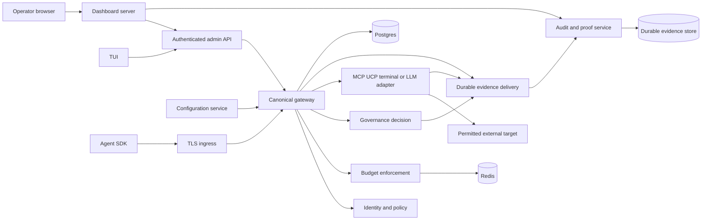

# Talos Architecture

**Updated:** 2026-10-10. This document separates the reviewed repository structure from the proposed supported runtime. It does not certify an existing deployment.

## 1. Architectural intent

Talos combines protocol libraries with an agent control plane and execution adapters. Contracts define shared schemas, canonicalization and vectors; services apply identity, policy and economic limits; connectors perform effects; audit/governance preserve evidence; dashboard/TUI expose administration and investigation.

Keep deterministic domain logic behind explicit ports. Cross-component boundaries use public packages/contracts or APIs. Workspace package dependencies may aid development, but deep imports into another repository's implementation must not become the integration contract.

## 2. Repository ownership

| Location | Responsibility | Boundary note |
| --- | --- | --- |
| `contracts/` | Schemas, vectors, canonical helpers, SDK release metadata | Normative shared boundary; change before consumers |
| `core/` | Rust cryptographic/domain implementation | Production core must be what conformance tests exercise |
| `talosprotocol/a2a` | Canonical A2A v1 core runtime engine | JSON-RPC 2.0 schemas, task lifecycles, and dual execution drivers |
| `talosprotocol/talos-a2a` | Zero-trust cryptographic security layer | W3C DIDs, ChaCha20-Poly1305 E2EE, capability tokens, and Merkle audit trees |
| `talos/`, `src/` | Root Python protocol, client, CLI, registry and network components | Overlapping implementations/entry points remain; designate one canonical owner before consolidation |
| `sdks/python`, `typescript`, `go`, `java`, `rust` | Public language integrations | Feature coverage differs; installed API and version profiles must be explicit |
| `services/ai-gateway` | LLM/MCP/A2A, keys, policy/RBAC, budgets, secrets and admin APIs | Candidate primary control/execution boundary; not the service selected by every deployment |
| `services/gateway` | Separate gateway/MCP/admin facade | Legacy deployment role and migration need an explicit decision |
| `services/audit` | Event integrity, persistence, Merkle roots/proofs, streaming | Authoritative evidence service, not proof of complete capture by itself |
| `services/governance-agent` | Capability/session authorization and execution recovery | Distinct from root `governance-agent/` and gateway TGA components |
| `services/configuration` | Config validation, draft/history/publish and export | Owns config state; must authenticate mutation and redact sensitive output |
| MCP/UCP/terminal services | Tool, commerce and process adapters | Effects must remain within authenticated authority |
| AI chat / AIOps services | Application/demo integrations | A demo is not evidence of platform-wide security guarantees |
| `site/dashboard`, `tools/talos-tui` | Operator clients | Server-side broker/session boundary; no secrets in browser bundles |
| `site/marketing`, `docs`, `examples` | Product explanation and runnable adoption paths | Claims follow supported artifacts and evidence |
| `deploy`, `.github`, `scripts` | Topology, builds, release and validation | Validate active paths and rendered configuration |

The workspace is a superproject with independently versioned submodules. A root commit and a dirty child tree are different baselines. `deploy/submodules.json`, `.gitmodules` and actual gitlinks currently disagree; resolve that drift rather than assume a single inventory is complete.

## 3. Runtime view

The diagram is the **target supported topology**, not a statement that current Compose/Kubernetes manifests already wire all these edges.

Registry-mediated encrypted messaging is a separate data path. Its confidentiality depends on the actual SDK/handshake/wire profile and key handling. An HTTP LLM or dashboard chat request does not automatically inherit that property.

## 4. Trust and request boundaries

1. **Ingress:** TLS, bounded request sizes/timeouts and approved routes. Only deliberate public endpoints are exposed.
2. **Authentication:** derive principal and credential identity from verified material. Headers are context only until authenticated.
3. **Authorization:** bind organization/team, method, resource, provider/tool, target, arguments, expiry and revocation. Reused sessions apply the same constraints.
4. **Budget:** reserve before execution; deny or follow a documented outage policy when enforcement is unavailable.
5. **Execution:** adapter rechecks relevant capability/target restrictions and reports a bounded, idempotent outcome.
6. **Evidence:** preserve request, decision, effect and settlement correlation; durable ownership precedes a promised durable acknowledgment.
7. **Presentation:** distinguish backend assertion, successful retrieval and independent verification.

Administration uses database-backed operator sessions and narrowly scoped broker tokens. Backend live RBAC must clamp requested permissions; UI route permissions alone do not grant authority. Direct service routes require service/user authentication as appropriate, plus tenant-aware authorization.

## 5. State ownership and consistency

See [DATA.md](DATA.md). Each aggregate has one service owner. Gateway SQL records own persisted configuration/tasks/keys/budget ledgers; Redis supports atomic enforcement/cache state with a specified recovery path; audit owns canonical retained evidence; governance owns trace/session transitions; dashboard owns operator authentication and setup jobs.

Use transactional outbox or an equivalent durable handoff for required audit delivery. The precise mechanism is a design decision; current fire-and-forget HTTP delivery does not satisfy it. Define at-least-once delivery with idempotent ingestion instead of claiming universal exactly-once effects.

Cross-service retries require stable idempotency keys bound to principal, operation and input digest. A crash between external effect and local acknowledgment is an explicit reconciliation state, not permission to replay blindly. Redis and SQL updates are not one transaction; reserve/settle design must account for their failure windows.

## 6. Deployment profiles and observed gaps

| Profile | Reviewed state | Required completion |
| --- | --- | --- |
| Root Compose | Local/dev defaults and multiple regional-named gateway containers | Clearly label local-only behavior and supplied defaults |
| Production Compose merge | Secret/auth improvements exist; selects `services/gateway`; inherited ports/networks remain; dashboard ingress route missing | Choose canonical gateway, explicit network/port overrides and full route/service-identity checks |
| Staging | Separate overlay with its own service settings | Use the same supported topology and auth semantics as production, with isolated data/secrets |
| Kubernetes production | Rendering fails on obsolete gateway patch; data/network/image configuration needs remediation | Renderable immutable release set, durable storage, migrations, secret provisioning and enforcing network-policy tests |
| Edge Nodes (Raspberry Pi 5 / macOS) | Operational low-latency A2A nodes | Runs `InMemoryTaskRunner` (<5ms round-trip), local SQLite audit store, and scoped capability enforcement |
| Distributed AI Cluster (Fedora `192.168.1.250`) | Operational multi-agent coordination cluster | Hosts federated Temporal server (`:7233` / `:8233`), DeepSeek-R1 inference (`:8080`), and Qdrant vector database (`:6333`) |

Three services named after regions on one host/shared database do not establish geographic resilience. A liveness response establishes process activity, not readiness of its policy/audit/storage dependencies.

## 7. Decisions to freeze before implementation

- Choose the supported gateway and migration/deprecation contract for the other facade.
- Select one production profile and define required versus optional services.
- Choose the canonical Python package/CLI implementation and adapters for legacy imports.
- Publish supported wire/handshake profiles and a compatibility policy for existing sessions.
- Resolve TGA implementation ownership and canonical evidence/digest encoding in contracts.
- Specify audit outage handling, budget recovery and proof trust-root distribution.
- Select native GitHub or Trunk queue ownership per repository while retaining reviews.

Record decisions in `docs/reference/decision-log.md` with status, alternatives, migration and reversal criteria. Do not treat the recommendation here as an already migrated system.

## 8. Migration and rollout

1. Make failures visible and pin the actual tested artifacts and submodule commits.
2. Add negative boundary tests, then repair auth, constraints, ratchet state and budget enforcement.
3. Freeze contracts; ship compatible producers/stores/consumers and explicit legacy decoding.
4. Repair deployment profiles and complete isolated end-to-end tests.
5. Roll out to an isolated environment, observe decision errors, audit lag, reserve reconciliation, proof failures and user journeys.
6. Promote only the tested release set. Preserve old artifacts and schema compatibility for rollback.

Use expand/migrate/contract database changes. Back up and restore-test before destructive migration. A rollback must not restore an authorization bypass, discard evidence, or reuse consumed cryptographic keys; disable the affected feature if reverting would do so.

## 9. Operational signals

Track identity/policy denials by reason, credential revocation delay, tool attempts/effects, budget reservations and reconciliation, audit acceptance/persistence/lag, evidence verification failures, task/stream backlog, setup lease expiry, dependency readiness and version skew. Avoid secret-bearing/high-cardinality labels. Correlation IDs connect layers; they do not substitute for authorization.

Release evidence and test scope are specified in [TESTING.md](TESTING.md). Existing deeper diagrams in `docs/architecture/` remain useful context, but claims about universal encryption, failover or completion require current integration evidence.
